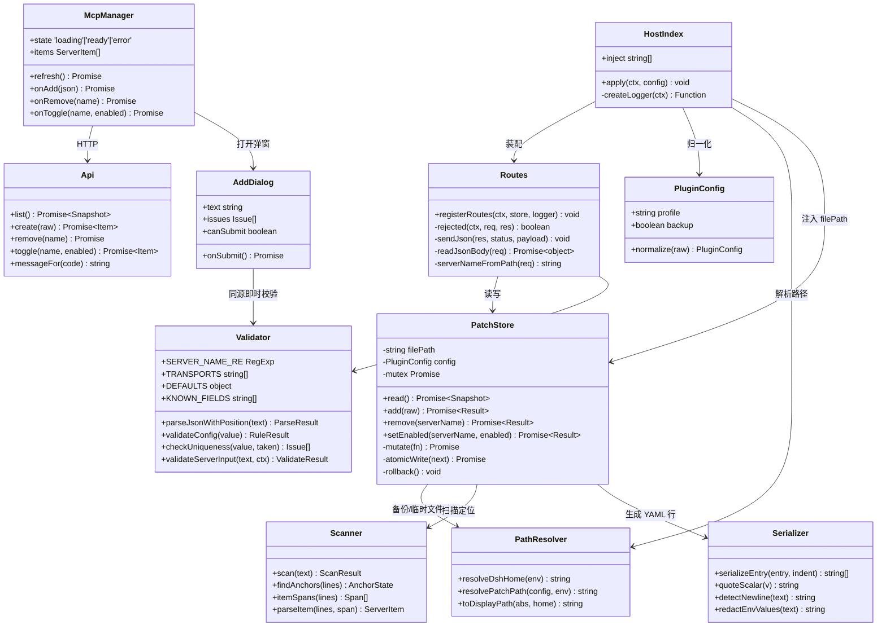
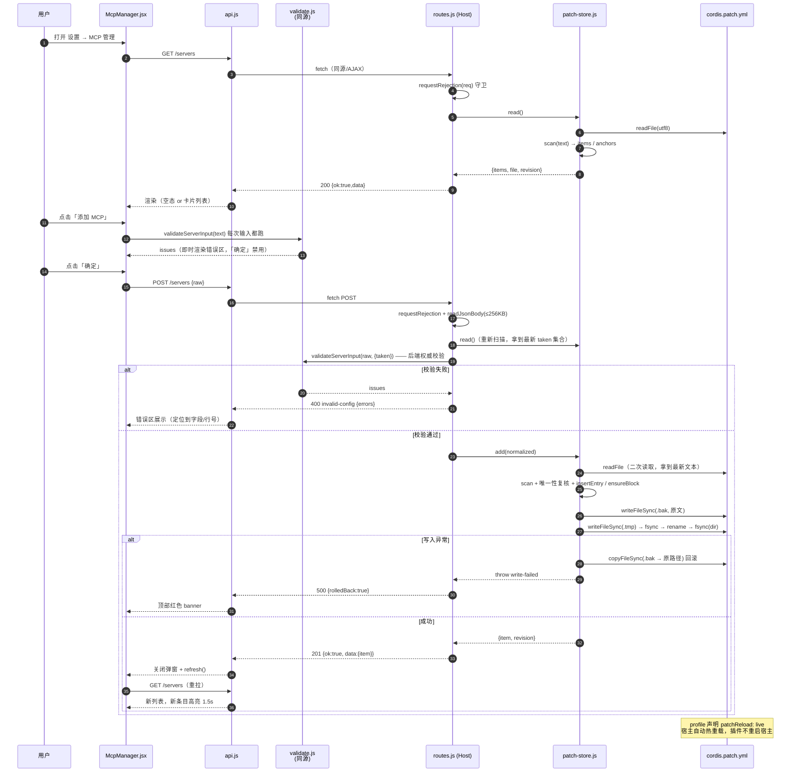
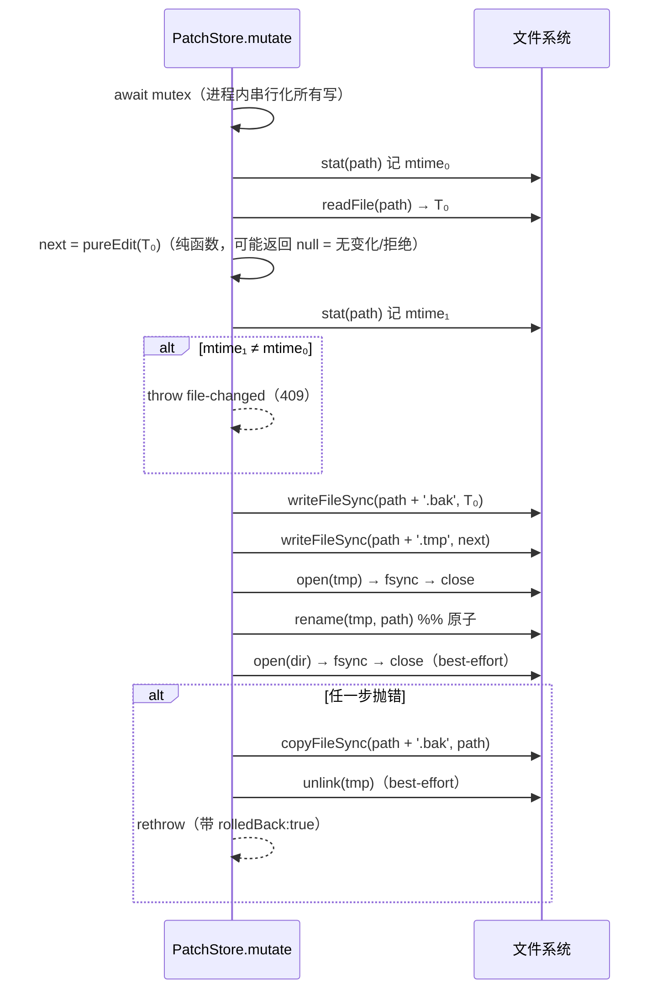
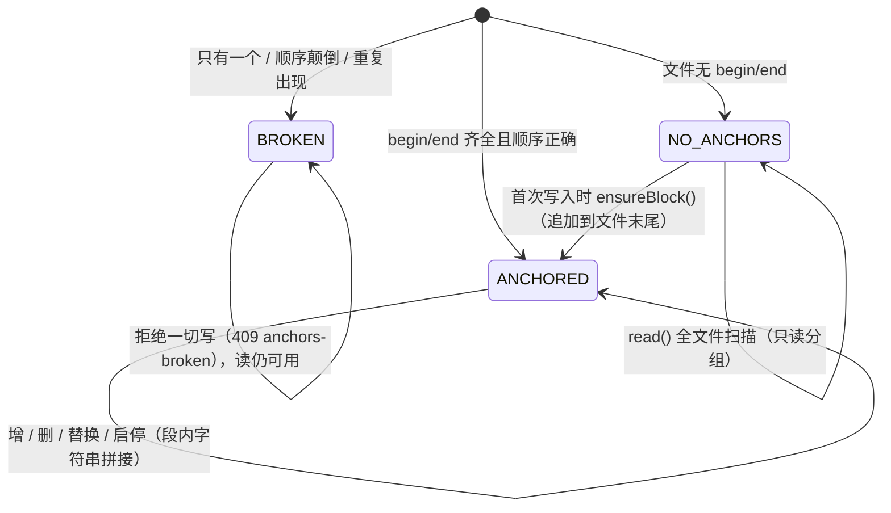
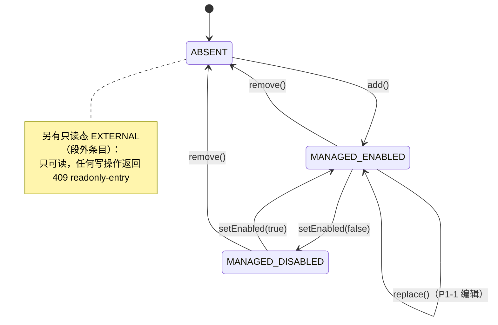

# 系统设计：dsh-mcpserver-manager

> 架构师：高见远 · 版本 v0.1.0 · 上游输入 `docs/software-company/prd.md`
> 本文是**唯一实现依据**。工程师若发现本文与 PRD 冲突，**以本文为准**（本文已吸收 team-lead 的 11 条裁决）。
> 本文不写业务代码，只写接口签名、类型、伪代码与不变量。

---

## 0. 一句话设计

一个**双面 cordis 插件**：Host 半用 Node 原生能力做「受管段感知的 `cordis.patch.yml` 行编辑器 + 4 个 HTTP 端点」，Client 半用 React（宿主注入）渲染一个**主题原生**的设置页；前后端共用**同一个** `src/validate.js` 模块做校验。运行时依赖为 **0**，构建期依赖只有 `esbuild`。

---

## 1. 实现方案与选型理由

### 1.1 技术挑战与对策

| # | 挑战 | 对策 |
|---|---|---|
| C1 | `cordis.patch.yml` 里有用户手写注释、`!!js` 自定义 tag、以及别的插件的条目；**全量 parse→dump 会毁掉它们** | **自研区块感知行编辑器**（§2）：只在自己维护的注释锚点段内做**字符串拼接式**增删，段外一个字节不动 |
| C2 | 刷新页面不能重复插入 | 条目以 `serverName` 为唯一键；写前**重新扫描**再定位；段锚点创建本身幂等 |
| C3 | 写入过程中崩溃/占用会写坏用户的配置文件 | tmp + `fsync` + `rename` 原子替换；写前落 `.bak`；任一异常自动回滚 |
| C4 | 前后端校验要一致（PRD P-3） | **同一个文件** `src/validate.js` 被 Host（ESM 运行时 import）与 Client（esbuild 打包内联）同时引用，物理上不可能分叉 |
| C5 | 主题要"像原生"，且不能 JS 判明暗 | 全部色值走 `--dsw-alias-*` + fallback；CSS 以 `<style>{css}</style>` 内联渲染（照 `dsh-hub` 客户端实测写法），作用域限定 `.dshmcp-` |
| C6 | `env` 里有 token | 明文永不越过 Host 边界：回显只给 `envKeys`，`raw` 文本在服务端脱敏后才下发；日志只打 serverName / 错误码 |
| C7 | React 不能被打进 bundle | `external: ['react','react-dom']` + `window.__ModuleLoader__.load({id, factory(require){...}})` 包装（照抄 `dsh-ssh/scripts/build.mjs`） |
| C8 | 用户可能已经手写过 MCP 条目但文件里还没有受管段 | 读是**全文件扫描**（与是否受管无关）；首次写入时**在文件末尾追加**受管段，用户原有条目原样留在段外 |

### 1.2 YAML 策略的最终取舍（核心决策）

**决策：零运行时依赖，自研「区块感知的行编辑器」。不引入 `yaml` / `js-yaml` / 任何 YAML 库。**

#### 权衡表

| 维度 | A. `yaml` 的 CST（`parseDocument` → 改 → `toString`） | B. **自研行编辑器（选定）** |
|---|---|---|
| 运行时依赖 | +1（≈200KB 源码 + 依赖树） | **0** |
| 头部注释保留 | ✅ CST 能保留 comment token | ✅ 天然保留（不碰就是保留） |
| **`!!js` 自定义 tag** | ❌ 默认解析直接抛 `unknown tag`；需自建 custom type 且必须 100% 复刻 cordis 的求值语义才能**反向 stringify 回 `!!js process.env.X`**；任何一处还原不一致就是**静默把用户的 token 表达式改成字面量或报错** | ✅ 原文就是文本，不解析即不破坏 |
| 段外条目格式保真 | ⚠️ CST 未触碰节点理论上保真，但缩进/引号/flow 风格在 re-emit 时仍有漂移风险；**无法用单测穷举用户可能写出的 YAML 形状** | ✅ **段外字节级不变**（可形式化证明，见 §7 I1） |
| 解析能力 | 完整 YAML 语义 | 只识别有限形状（顶层 `- ` 序列 + 2 空格缩进键 + 4 空格 `config` 子块） |
| 解析不出来的后果 | — | 降级为「不可解析 · 只读」展示，**不报错、不写、不猜** |
| 读路径能否用库、写路径用文本 | 可以，但读路径同样会被 `!!js` 卡住（仍需自定义 type），收益为负 | — |
| 代码量 | 少 | 约 250 行（扫描 + 拼接 + 序列化） |
| 失败爆炸半径 | **用户的整个配置文件**（不可逆） | 仅受管段内 |

**决定性理由（一句话）**：本文件是**用户资产**且**允许 cordis 私有的 `!!js` 扩展**。在一个「写坏了不可逆」的文件上，用一个**通用 YAML 库去赌它的 tag 还原与格式保真**是不划算的；而我们真正需要的操作只有「在固定位置插入/替换/删除一段我们自己生成的规范化文本」，这一操作的完备实现只需要 ~250 行、且能被单测穷举。**通用性换不来安全性。**

> 补充事实：`dsh-ssh` 的 `package.json` 带了 4 个运行时依赖（`ssh2`/`zod`/…），而本插件的业务只有「读文本、改文本、写文本」，是**唯一一个可以做到零依赖的插件**。把它做成零依赖，安装更快、供应链面更小、DSH Hub 审核更稳。

#### 行编辑器要处理的形状（明确能力边界）

```
支持（必须）：
  顶层序列项      /^- /（列 0，无前导空格）
  条目级键        缩进 2 的 `key: value`，或 `- id: xxx` 的同行内联 `id`
  config 子块     `config:` 之后缩进 > 2 的连续行，键在缩进 4
  值形态          裸标量 / '单引号' / "双引号" / [flow seq] / {flow map} / !!js 表达式
不支持（降级，不报错）：
  嵌套超过 2 层、锚点引用（&a/*a）、多文档（---）、块标量（| / >）、
  顶层为映射而非序列、序列项缩进不为 0
降级行为：该条目 → { parsable: false, managed: false }，UI 显示「无法解析 · 只读」并给出 raw 文本
```

### 1.3 停用语义：cordis 原生 `disabled`（采纳 Q3 裁决）

采用 `disabled: true`，**废弃 PRD §2.4 的「注释搬运」方案**。理由（team-lead 已核实）：
`@deepseek-ai/cordis-plugin-loader/src/config/entry.ts` 声明 `disabled?: boolean|null`，README 语义为 "Stops the entry and prevents it from starting"，且支持 `!!js` 表达式。

**但要在代码里留一个开关**（这是我对 C1 类风险的兜底）：
```js
// src/patch-store.js
export const DISABLE_STRATEGY = 'native-key'; // 'native-key' | 'comment-block'
```
若上线后发现 `disabled` 在 patch 层不生效，改这一个常量即可切回注释搬运（两条实现路径都按 §6.4 的 `applyDisable` 签名并行保留）。**两个策略共用同一套扫描器，切换成本 ≈ 20 行。**

由此，**受管段从"两个"（managed + disabled）简化为"一个"**：

```yaml
# >>> dsh-mcpserver-manager:managed:begin (由「设置 → MCP 管理」维护，请勿手改)
- id: mcp-github
  name: '@deepseek-ai/dsh-mcp-client'
  config:
    serverName: github
    transport: stdio
    command: npx
    args:
      - '-y'
      - '@modelcontextprotocol/server-github'
    env:
      GITHUB_TOKEN: 'ghp_xxx'
    toolCallTimeoutMs: 60000
    maxInstructionBytes: 32768
    failOnStartupError: false
- id: mcp-foo
  name: '@deepseek-ai/dsh-mcp-client'
  disabled: true
  config:
    serverName: foo
    transport: stdio
    command: node
# <<< dsh-mcpserver-manager:managed:end
```

> **与官方 README 的一处有意偏离**：官方示例用 flow 风格（`args: [...]`, `env: {...}`），我们生成**块风格**。原因：块风格对本项目的自研扫描器是**可无损往返**的，而 flow 风格里出现 `!!js`、引号转义、嵌套对象时会显著增加解析歧义。两者对 cordis 完全等价。用户手写的 flow 风格我们**照读不误**（只是解析不出细节时降级为只读）。

### 1.4 架构分层

```
┌──────────── Client 半（esbuild → lib/client.js 单文件 CJS）────────────┐
│ entry → launchpad(slots.inject) → McpManager → Toolbar/EmptyState/     │
│         ServerList → ServerCard → AddDialog/ConfirmDialog              │
│ 共享：../validate.js（同源校验） · api.js（fetch 封装）· styles.js（CSS） │
└──────────────────────────┬────────────────────────────────────────────┘
                           │  HTTP  /api/dsh-mcpserver-manager/*
┌──────────────────────────┴──────── Host 半（Node ESM，原样拷贝 lib/）──┐
│ index.js(inject/apply) → routes.js（守卫 + 4 端点）→ patch-store.js     │
│                                                  ├→ paths.js（路径解析）│
│                                                  ├→ serialize.js（→YAML│
│                                                  └→ validate.js（同源）│
└────────────────────────────────────────────────────────────────────────┘
```

依赖方向严格单向：`routes → patch-store → {paths, serialize}`，`routes → validate`。**`validate.js` 不 import 任何 Node 内置模块**（这是它能被浏览器打包的前提，是硬约束）。

---

## 2. 文件列表

| # | 路径 | 职责（一句话） |
|---|---|---|
| 1 | `package.json` | 依赖声明 + `dsh.bundle` / `dsh.client` / `exports` / `files` 清单（§3.1 形状） |
| 2 | `.gitignore` | 忽略 `node_modules/`、`lib/`（产物）、`.DS_Store` |
| 3 | `LICENSE` | MIT（照抄 dsh-ssh） |
| 4 | `icon.svg` | DSH Hub 市场图标（≤64×64，纯 SVG，无外链） |
| 5 | `README.md` | 安装/用法/配置格式/写入位置/恢复方法（DSH Hub 索引用，`keywords` 含 `dsh-plugin`） |
| 6 | `cordis.patch.yml` | **bundle 层**：声明本插件自身的 `insert` 条目（不是运行时写的那个文件） |
| 7 | `scripts/build.mjs` | esbuild 打 client + `__ModuleLoader__` 包装 + Host 半目录扫描拷贝 + `node --check` + 体积门禁 + `--check` 模式（照抄 dsh-ssh） |
| 8 | `src/index.js` | Host 入口：`export const inject` + `export function apply`，装配 config/routes/logger |
| 9 | `src/config.js` | 插件自身 Config schema 与归一化（`profile`、`backup`） |
| 10 | `src/paths.js` | 路径解析纯函数：`DSH_HOME` → `~/.dsh`，profile → `cordis.patch.yml`（可注入、可测） |
| 11 | `src/validate.js` | **校验规则引擎（前后端同源单一数据源）**：解析 + 16 条规则 + 行号提取 |
| 12 | `src/serialize.js` | `config` 对象 → 规范化 YAML 行数组；`env` 脱敏；换行符探测 |
| 13 | `src/patch-store.js` | 受管段读写核心：扫描 / 增 / 删 / 替换 / 启停 / 原子写 / 备份回滚 |
| 14 | `src/routes.js` | 4 个 HTTP 端点的全部逻辑（首行 `requestRejection` 守卫）+ 错误码表 |
| 15 | `src/client/entry.js` | 再导出 `{ inject, apply }`（加载器契约） |
| 16 | `src/client/launchpad.js` | `ctx.slots.inject('settings.section', ...)` 注册（唯一宿主耦合点） |
| 17 | `src/client/McpManager.jsx` | 页面容器：拉数据 / 三态分发 / 全局 banner / 新条目高亮 |
| 18 | `src/client/Toolbar.jsx` | 标题行 + 「添加 MCP」主按钮 + 刷新（搜索/筛选 P1 预留骨架） |
| 19 | `src/client/EmptyState.jsx` | 空态（图标 + 主副文案 + 主按钮） |
| 20 | `src/client/ServerList.jsx` | 卡片列表 + 只读分组标题 |
| 21 | `src/client/ServerCard.jsx` | 单卡片：状态点 / 名称 / 命令行 / 元信息 / ⋯ 菜单 / 启停 |
| 22 | `src/client/AddDialog.jsx` | 添加弹窗：JSON 编辑器 + 示例下拉 + 实时错误区 + 写入位置提示 |
| 23 | `src/client/ConfirmDialog.jsx` | 删除二次确认弹窗 |
| 24 | `src/client/Icons.jsx` | 内联 SVG 图标集（+ / ⋯ / 刷新 / 警告 / 空态，16px，stroke 1.5） |
| 25 | `src/client/styles.js` | 导出 CSS 字符串，作用域 `.dshmcp-`，全量 `var(--dsw-alias-*, fallback)` |
| 26 | `src/client/api.js` | `fetch` 封装 + 错误码 → 中文文案映射 |
| 27 | `tests/patch-store.test.js` | **风险最高**：受管段读写幂等 / 回滚 / 段外字节不变 / 锚点缺失/损坏 |
| 28 | `tests/validate.test.js` | 16 条规则的用例表（前后端共用的同一份断言） |
| 29 | `tests/serialize.test.js` | 序列化往返 + `env` 脱敏 + 换行符 |
| 30 | `docs/software-company/architecture.md` | 本文 |
| 31 | `docs/software-company/tasks.md` | 任务分解 |

**共 31 个文件**（含 2 篇文档与 3 个测试）。

---

## 3. 数据结构与接口定义

### 3.1 插件自身 Config（cordis 层）

```js
// src/config.js
/** @typedef {{ profile: string, backup: boolean }} PluginConfig */

/** 默认值。 */
export const DEFAULT_CONFIG = Object.freeze({ profile: 'web', backup: true });

/**
 * 归一化：未知/非法值一律回落默认，**永不抛错**（配置写错不该让插件消失）。
 * @param {unknown} raw
 * @returns {PluginConfig}
 */
export function normalizeConfig(raw) { /* profile: /^[A-Za-z0-9_-]{1,32}$/ 否则 'web' */ }
```

对应 cordis 层声明（`~/.dsh/profiles/web/cordis.yml` 或 patch 层）：

```yaml
- id: dsh-mcpserver-manager
  name: 'dsh-mcpserver-manager'
  config:
    profile: web     # 可选；不写即 'web'
    backup: true     # 可选
```

本插件自带的 `cordis.patch.yml`（bundle 层，与上面是**两个不同文件**）：

```yaml
- insert:
    - id: dsh-mcpserver-manager
      name: 'dsh-mcpserver-manager'
```

### 3.2 路径解析（Q6）

```js
// src/paths.js
/**
 * 解析 DSH 根目录。
 * 优先级：入参 env.DSH_HOME > 入参 env.HOME/.dsh > os.homedir()/.dsh
 * @param {NodeJS.ProcessEnv} env
 * @returns {string}
 */
export function resolveDshHome(env) {}

/**
 * 解析 patch 文件绝对路径（纯函数，无 I/O，可直接单测）。
 * @param {{ profile?: string }} config
 * @param {NodeJS.ProcessEnv} env
 * @returns {string} <dshHome>/profiles/<profile>/cordis.patch.yml
 */
export function resolvePatchPath(config, env = process.env) {}

/**
 * 展示用路径：把 dshHome 前缀替换成 `~`。
 * @param {string} abs @param {string} home
 * @returns {string}
 */
export function toDisplayPath(abs, home) {}
```

### 3.3 扫描器输出：`ServerItem`

```js
/** @typedef {Object} ServerItem
 * @property {string|null} id            条目的 `id`（解析不出为 null）
 * @property {string|null} serverName    身份键；null 表示不可解析
 * @property {'stdio'|'streamable-http'|null} transport
 * @property {string}     summary        'npx -y @modelcontextprotocol/server-github' | 'http://localhost:3000/mcp' | ''
 * @property {string|null} command
 * @property {string[]}   args
 * @property {string|null} url
 * @property {string[]}   envKeys        仅 key，永不回显值
 * @property {string|null} cwd
 * @property {number|null} toolCallTimeoutMs
 * @property {boolean}    enabled        = !disabled
 * @property {boolean}    managed        是否在受管段内（决定可编辑/删除/启停）
 * @property {boolean}    parsable       false → 只展示 raw，不提供任何写操作
 * @property {string}     raw            条目原始 YAML 文本（**已脱敏**）
 * @property {'native-key'|'expression'|null} disabledBy  disabled 值的形态（表达式不可自动启停）
 */
```

### 3.4 受管段读写：`PatchStore`

```js
// src/patch-store.js
/** 受管段锚点（常量，改这里等于改协议，必须同步 README）。 */
export const BEGIN_ANCHOR = '# >>> dsh-mcpserver-manager:managed:begin (由「设置 → MCP 管理」维护，请勿手改)';
export const END_ANCHOR   = '# <<< dsh-mcpserver-manager:managed:end';

/**
 * 创建 store。**filePath 可注入 → 全部逻辑可在 tmp 目录里单测。**
 * @param {{ filePath?: string, config?: object, env?: object, fs?: object, now?: () => number }} options
 */
export function createPatchStore(options = {}) {}

/** @typedef {Object} PatchStore
 * @property {() => Promise<{ file: string, fileDisplay: string, exists: boolean, revision: number, checksum: string, items: ServerItem[], anchors: 'ok'|'missing'|'broken' }>} read
 * @property {(raw: string) => Promise<{ item: ServerItem, revision: number }>} add
 * @property {(serverName: string) => Promise<{ revision: number }>} remove
 * @property {(serverName: string, enabled: boolean) => Promise<{ item: ServerItem, revision: number, changed: boolean }>} setEnabled
 */
```

**内部纯函数（全部可直接单测，是 `tests/patch-store.test.js` 的靶子）：**

```js
/** 全文件扫描：返回所有 `name: '@deepseek-ai/dsh-mcp-client'` 的条目 + 锚点状态。 */
export function scan(text) -> { items: ServerItem[], anchors: 'ok'|'missing'|'broken', beginLine: number|-1, endLine: number|-1, newline: '\n'|'\r\n' }

/** 在受管段内追加一条（段不存在则先建段）。纯函数 text → text。 */
export function insertEntry(text, lines) -> string

/** 按 serverName 移除受管段内的条目；不存在返回 null。 */
export function removeEntry(text, serverName) -> string | null

/** 替换受管段内同名条目（P1-1 编辑用；P0 已实现，路由未暴露）。 */
export function replaceEntry(text, serverName, lines) -> string | null

/** 设置/清除 disabled（受 DISABLE_STRATEGY 开关控制）。 */
export function applyDisable(text, serverName, disabled) -> string | null

/** 确保段存在（幂等）。 */
export function ensureBlock(text) -> string
```

### 3.5 HTTP API

**Base**：`/api/dsh-mcpserver-manager`
**路由形态**（宿主 webServer 只有 `exact` / `prefix`，无路径参数 —— 照 `dsh-ssh` 实测）：

| kind | path | 处理 |
|---|---|---|
| `exact` | `/api/dsh-mcpserver-manager/servers` | `GET`（列表）、`POST`（新增） |
| `prefix` | `/api/dsh-mcpserver-manager/servers/` | `DELETE /servers/<serverName>`、`POST /servers/<serverName>/toggle` |

#### 统一信封

```jsonc
// 2xx
{ "ok": true, "data": { /* 见下 */ }, "revision": 1719500000123 }
// 非 2xx
{ "ok": false, "error": { "code": "duplicate-server", "message": "serverName \"github\" 已存在，请换一个名字",
                          "errors": [ { "level":"error", "code":"E_DUP", "path":"$.serverName", "line":2, "column":18, "message":"…" } ],
                          "rolledBack": true } }
```

> 与 PRD P0-5 的偏差说明（**以本文为准**）：PRD 写「500 返回 `{rollback:true}`」，本文统一为 `{ok:false, error:{code,message,rolledBack}}`。前端只需判 `ok` 一个字段，不需按状态码分支两套解析路径。

#### E1. `GET /servers`

```json
{ "ok": true, "data": {
    "file": "/Users/leiyu/.dsh/profiles/web/cordis.patch.yml",
    "fileDisplay": "~/.dsh/profiles/web/cordis.patch.yml",
    "dshHome": "/Users/leiyu/.dsh",
    "profile": "web",
    "exists": true,
    "anchors": "ok",
    "items": [ /* ServerItem[]，已脱敏 */ ]
}, "revision": 1719500000123 }
```
- 文件不存在 → `200 + { exists:false, items:[], anchors:'missing' }`（**不报错**，空态是默认路径）
- `anchors: 'broken'` → 仍返回 200，UI 顶部挂只读告警（写操作会被后端拒）

#### E2. `POST /servers`

```jsonc
// 请求
{ "raw": "{\n  \"serverName\": \"github\",\n  \"transport\": \"stdio\",\n  \"command\": \"npx\"\n}" }
// 201
{ "ok": true, "data": { "item": { /* ServerItem */ } }, "revision": 1719500000456 }
```
- body 上限 **256KB**（配置再长也长不过一块剪贴板；超出 → 413 `body-too-large`）
- 后端**重新执行完整校验**（前端结果仅供参考），失败 → 400 `invalid-config` + `errors[]`
- 重名（含与只读条目重名）→ 409 `duplicate-server`

#### E3. `DELETE /servers/<serverName>`

```jsonc
{ "ok": true, "data": { "removed": "github" }, "revision": ... }
```
- 段内不存在 → 404 `unknown-server`（UI："该条目已不存在，请刷新"）
- 名字命中**只读**条目 → 409 `readonly-entry`（UI："该条目非本插件管理，无法删除"）

#### E4. `POST /servers/<serverName>/toggle`

```jsonc
// 请求
{ "enabled": false }
// 200
{ "ok": true, "data": { "item": {/* ServerItem */}, "changed": true }, "revision": ... }
```
- `changed:false` 表示状态已是目标值（幂等，未落盘）
- `disabled` 值是 `!!js` 表达式 → 409 `disable-by-expression`（不自动改写用户表达式）

#### 错误码表（前端 `api.js` 按 `code` 映射中文文案）

| code | HTTP | 触发 | 前端文案 |
|---|---|---|---|
| `invalid-json` | 400 | R1 失败 | `JSON 语法错误（第 N 行第 M 列）：<原因>` |
| `invalid-config` | 400 | R2–R15 任一 ERROR | 逐条渲染 `errors[]` |
| `duplicate-server` | 409 | R5 / id 撞车 | `serverName "x" 已存在，请换一个名字` |
| `unknown-server` | 404 | 增删启停定位不到 | `该条目已不存在，请刷新列表` |
| `readonly-entry` | 409 | 操作段外条目 | `该条目非本插件管理，无法修改` |
| `unparsable-entry` | 409 | 条目不可解析 | `该条目格式超出可解析范围，请手工编辑配置文件` |
| `anchors-broken` | 409 | 锚点缺失一半/顺序颠倒/重复 | `受管段标记被破坏，请手工修复 cordis.patch.yml` |
| `file-changed` | 409 | 读后写前 mtime 变了 | `配置文件已被外部修改，请刷新后重试` |
| `disable-by-expression` | 409 | disabled 是 `!!js` | `该条目的启用状态由表达式控制，请手工修改` |
| `file-unreadable` | 500 | 读失败 | `无法读取配置文件：<原因>` |
| `write-failed` | 500 | 写失败（**已回滚**） | `写入失败，文件已回滚：<原因>` |
| `body-too-large` | 413 | >256KB | `配置内容过大` |
| `method-not-allowed` | 405 | 方法不匹配 | —（前端不应触发） |

### 3.6 类图



---

## 4. 校验规则清单（前后端同源）

### 4.1 同源机制（**这是 P-3 的落地答案**）

```
src/validate.js  ←──────────────┐
   ▲  (import)                  │  (import '../validate.js')
   │                            │
src/routes.js (Host)     src/client/AddDialog.jsx (Client)
   │                            │
lib/validate.js          esbuild 把同一份源码内联进 lib/client.js
（build.mjs 目录扫描拷贝）      （external 只排除 react/react-dom）
```

- **物理上只有一个文件**，不存在"两份实现会漂移"的可能；
- Host 侧运行时 `import './validate.js'` → 命中 `lib/validate.js`（build.mjs 扫描 `src/*.js` 时一并拷贝）；
- Client 侧 `import { validateServerInput } from '../validate.js'` → esbuild 内联；
- **硬约束：`src/validate.js` 不得 import 任何 Node 内置模块、不得访问 `window`/`document`。**（构建期可用 `npm run check` + 一条 grep 断言守住，不另建 lint）

### 4.2 规则表（PRD §3.3 的 16 条，补上 `code` 与 `path`）

| # | 规则 | 级别 | code | `path` | 判据 | 文案 |
|---|---|---|---|---|---|---|
| R1 | JSON 可解析 | ERROR | `E_JSON` | `$` | `JSON.parse` 成功 | `JSON 语法错误（第 N 行第 M 列）：<原因>` |
| R2 | 顶层为对象 | ERROR | `E_ROOT` | `$` | 非数组、非 null | `配置必须是一个 JSON 对象` |
| R3 | transport 合法 | ERROR | `E_TRANSPORT` | `$.transport` | ∈ {stdio, streamable-http} | `transport 必填，只能是 stdio 或 streamable-http` |
| R4 | serverName 格式 | ERROR | `E_NAME` | `$.serverName` | `/^[A-Za-z0-9_-]{1,32}$/` | `serverName 只能包含字母、数字、下划线和连字符，长度 1–32` |
| R5 | serverName 唯一 | ERROR | `E_DUP` | `$.serverName` | 不在 `taken` 集合 | `serverName "x" 已存在，请换一个名字` |
| R6 | stdio 需要 command | ERROR | `E_COMMAND` | `$.command` | 非空字符串 | `stdio 传输必须提供 command` |
| R7 | args 类型 | ERROR | `E_ARGS` | `$.args` | 可选；字符串数组 | `args 必须是字符串数组` |
| R8 | env 类型 | ERROR | `E_ENV` | `$.env` | 可选；string→string | `env 必须是「字符串: 字符串」对象` |
| R9 | cwd 类型 | ERROR | `E_CWD` | `$.cwd` | 可选；非空字符串 | `cwd 必须是字符串` |
| R10 | http 需要 url | ERROR | `E_URL` | `$.url` | `new URL()` 可解析且协议 ∈ http/https | `streamable-http 传输必须提供合法的 url` |
| R11 | headers 类型 | ERROR | `E_HEADERS` | `$.headers` | 可选；string→string | `headers 必须是「字符串: 字符串」对象` |
| R12 | toolCallTimeoutMs | ERROR | `E_TIMEOUT` | `$.toolCallTimeoutMs` | 可选；1–600000 整数 | `toolCallTimeoutMs 必须是 1–600000 的整数` |
| R13 | maxInstructionBytes | ERROR | `E_BYTES` | `$.maxInstructionBytes` | 可选；正整数 | `maxInstructionBytes 必须是正整数` |
| R14 | failOnStartupError | ERROR | `E_FAIL` | `$.failOnStartupError` | 可选；布尔 | `failOnStartupError 必须是布尔值` |
| R15 | 字段与传输不匹配 | ERROR | `E_MISMATCH` | `$.<field>` | stdio 禁 `url`/`headers`；http 禁 `command`/`args`/`cwd` | `stdio 传输不支持 url 字段` |
| R16 | 未知字段 | WARN | `W_UNKNOWN` | `$.<field>` | 不在白名单 | `未知字段 "foo" 不在已知字段内，将原样写入；若 DSH 不支持则会被忽略` |

**默认值（后端补齐后写入）**：`toolCallTimeoutMs=60000`、`maxInstructionBytes=32768`、`failOnStartupError=false`。

### 4.3 模块签名

```js
// src/validate.js
export const SERVER_NAME_RE = /^[A-Za-z0-9_-]{1,32}$/;
export const TRANSPORTS = Object.freeze(['stdio', 'streamable-http']);
export const DEFAULTS = Object.freeze({ toolCallTimeoutMs: 60000, maxInstructionBytes: 32768, failOnStartupError: false });
export const KNOWN_FIELDS = Object.freeze([ /* serverName, transport, command, args, env, cwd, url, headers,
                                               toolCallTimeoutMs, maxInstructionBytes, failOnStartupError, reconnect */ ]);

/** @typedef {{level:'error'|'warn', code:string, path:string, line?:number, column?:number, message:string}} Issue */

/** JSON.parse + 行号：优先从 V8 的 "at position N" 自行换算，失败则用原始 message。 */
export function parseJsonWithPosition(text) /* -> {ok:true,value} | {ok:false,line?,column?,message} */ {}

/** 不含唯一性的纯规则校验（浏览器可直接调）。 */
export function validateConfig(value) /* -> {issues: Issue[], normalized: object|null} */ {}

/** 唯一性：taken 为已有 serverName 集合 + 已有 id 集合。 */
export function checkUniqueness(normalized, taken) /* -> Issue[] */ {}

/** 组合入口：前端与后端都只调这一个。 */
export function validateServerInput(text, { existingServerNames = [], existingIds = [] } = {})
  /* -> {ok:boolean, value:object|null, issues:Issue[]} */ {}
```

**R5 的作用域（Q1/Q2 落地）**：`existingServerNames` = **全文件**所有可解析的 `dsh-mcp-client` 条目的 serverName（**含只读条目**——serverName 是工具 namespace，撞了就撞了）；`existingIds` = 全文所有顶层条目的 `id`（防御性：若 `mcp-<name>` 已被别的插件当 id 占用，同样拒绝）。**不做自动 `-2` 后缀。**

### 4.4 未知字段（Q8 = 警告放行）的实现口径

放行 = **校验通过 + 原样透传写入**（排在 canonical 字段之后，按用户输入顺序）。不丢弃——若丢弃，未来官方新增字段时用户会静默丢失配置。文案已按此改写（见 R16）。**这是我对 Q8 的实现细化，需 team-lead 知会（见 §9-A2）。**

---

## 5. 程序调用流程

### 5.1 主流程：打开页面 → 添加 → 回显



### 5.2 原子写子流程（所有写路径共用）



### 5.3 删除 / 启停

两条路径与 §5.1 的「成功」分支同构，仅把 `insertEntry` 换成 `removeEntry` / `applyDisable`，且都在 `mutate()` 内串行执行。差异：
- 删除成功后前端**不重拉**，本地按 serverName 从列表移除后再静默 `refresh()`（保证与文件一致）；
- 启停成功后直接用响应里的 `item` 局部替换该卡片（`changed:false` 时连局部更新都跳过）。

---

## 6. 受管段读写：状态机与幂等性论证

### 6.1 文件级状态机（关于锚点）



- `NO_ANCHORS` 下**读依然工作**：所有 MCP 条目都以 `managed:false` 呈现（这正是「用户已手写 MCP 但还没有受管段」的初始状态）。
- 从 `NO_ANCHORS` 到 `ANCHORED` 只在**写入**时发生，且 `ensureBlock()` 幂等。

### 6.2 条目级状态机



### 6.3 幂等性论证

| 操作 | 前置 | 后置 | **重复执行一次** |
|---|---|---|---|
| `ensureBlock()` | NO_ANCHORS | ANCHORED | 第二次：锚点已存在 → **原样返回**，输出与输入逐字节相同 |
| `add(s)` | ABSENT | MANAGED_ENABLED | 第二次：写前重新 `scan` 命中同名 → **409，不落盘** |
| `remove(s)` | ENABLED/DISABLED | ABSENT | 第二次：定位不到 → **404，不落盘** |
| `setEnabled(s,false)` | ENABLED | DISABLED | 第二次：已是目标态 → **`changed:false`，跳过落盘** |
| `setEnabled(s,true)` | DISABLED | ENABLED | 同上 |
| `read()` | 任意 | 不变 | 纯函数（文件内容 → items），**天然幂等** |

**为什么刷新页面不会重复插入**：`add()` 的唯一性判断发生在**写入前的最后一次 `scan`** 上，而不是页面内存的旧列表上。即使两个浏览器标签并发提交同名 MCP，也只有一个能越过 `add()`（另一个拿到 409）——因为 `mutate()` 用进程内 mutex **把「读-改-写」整段串行化**了。

### 6.4 不变量（单测必须断言）

| # | 不变量 | 断言方式 |
|---|---|---|
| **I1** 段外字节不变 | 令 `T₀ = B₀ ⊕ M₀ ⊕ E₀`（段前/段内/段后）。任意操作后 `T₁ = B₀ ⊕ M₁ ⊕ E₀` | `tests/patch-store.test.js`：对 6 种初始文件各跑 20 次随机增删，`B₀`/`E₀` 的 md5 与初始一致 |
| **I2** 崩溃安全 | 任意时刻文件内容 ∈ {`T₀`, `T₁`} | 注入一个会在 `rename` 前抛错的 fs stub，断言文件 == `T₀` |
| **I3** 回滚完备 | 写失败后文件 md5 == 操作前 md5，且 `.bak` 存在 | 注入 `writeFileSync(tmp)` 抛错，断言回滚被调用且内容一致 |
| **I4** 读不改 | `read()` 前后文件 mtime 不变 | stat 前后比对 |
| **I5** 追加不破坏 | 从 `NO_ANCHORS` 首次写入后，原文件全部内容仍是结果的前缀 | `T₁.startsWith(T₀')`（`T₀'` = 补了结尾换行/空行的 `T₀`） |
| **I6** 脱敏 | `items[].raw` 中不出现任何 env 明文值 | 用 `env: {TOKEN:'secret-abc'}` 断言 `raw` 不含 `secret-abc` 但含 `TOKEN` |

### 6.5 关键实现细节（工程师照此写，别自由发挥）

1. **换行符**：`detectNewline(text)` 探测文件首个 `\r\n`，有则新增行用 `\r\n`，否则 `\n`。**绝不归一化整个文件。**
2. **条目行区间** `span = [start, nextTopLevelDash)`，再去掉尾部空行。段内注释视为所属条目的一部分（插件自身生成的条目不含注释）。
3. **建段位置**：文件末尾。若末尾不是空行 → 先补一个空行；若文件不以换行结尾 → 先补换行。空文件/纯注释文件 → 直接追加段。
4. **插入位置**：`END_ANCHOR` 所在行的行首。段为空时即为 `begin` 与 `end` 之间。
5. **`env` 脱敏**：`raw` 下发前，`env` 子块内每个值：以 `!!js` 开头 → 原样保留；否则替换为 `'••••'`。`envKeys` 从原文解析。
6. **序列化键序**（canonical，保证同一输入两次生成结果一致）：
   `serverName, transport, command, args, env, cwd, url, headers, toolCallTimeoutMs, maxInstructionBytes, failOnStartupError, reconnect, ...未知字段（输入顺序）`
7. **字符串一律单引号**，内部 `'` 转义为 `''`；空串 `''`；数字/布尔裸写。
8. **并发**：`mutate()` 内一条 Promise 链做 mutex，覆盖「备份 → 写 tmp → rename → 回滚」全段。
9. **不缓存文件内容**：每次 `read()` / `mutate()` 都重新 `readFile`。profile 已声明 `patchReload: live`，宿主也会热重载，缓存只会制造不一致。

---

## 7. 依赖包

### Runtime dependencies

**零。** `dependencies` 字段不出现（或显式 `{}`）。

### devDependencies

```
- esbuild@^0.24.0  客户端 bundle 唯一构建工具（照抄 dsh-ssh，行为已在本机验证）
```

### 不使用（及其原因）

| 不用 | 原因 |
|---|---|
| `yaml` / `js-yaml` | 见 §1.2：`!!js` 自定义 tag 无法安全往返；格式保真不可穷举验证 |
| `zod` 等校验库 | 规则只有 16 条且要给出**行号**，手写更可控；且它需要被浏览器打包（体积） |
| React / ReactDOM | 由宿主 `factory(require)` 注入，`external` 排除 |
| MUI / Tailwind / 图标库 | PRD D6：bundle 是每次启动都要读入执行的产物，且不引第三方 UI 才能贴合原生主题 |
| 测试框架 | Node ≥18 内置 `node:test` + `node:assert/strict` 足够 |

### 体积门禁

`scripts/build.mjs` 内 `MAX_CLIENT_BYTES = 120 * 1024`（PRD P1-9 要求，**P0 就做**，成本为零）。实测预期 25–40KB，门禁极宽松，只起防回归作用。

---

## 8. 共享知识（跨文件约定）

| 类别 | 约定 |
|---|---|
| **API 前缀** | `/api/dsh-mcpserver-manager`（与包名一致；**client 侧 fetch 用相对路径**，照 `dsh-wallpaper`） |
| **响应信封** | `{ok:true,data,revision}` / `{ok:false,error:{code,message,errors?,rolledBack?}}` |
| **日志前缀** | `[dsh-mcpserver-manager] `；**只打 serverName / 错误码 / 文件路径**，永不打 `raw`、`env` 值、token |
| **CSS 类名** | 一律 `.dshmcp-` 前缀（如 `.dshmcp-card`、`.dshmcp-dialog`） |
| **CSS 注入** | `<style>{CSS}</style>` 由 `McpManager` 渲染（照 `dsh-hub` 实测写法），**不用 DOM API** |
| **主题** | 全部 `var(--dsw-alias-xxx, #fallback)`；**禁止任何 JS 明暗判断**；fallback 仅兜底 |
| **锚点串** | `# >>> dsh-mcpserver-manager:managed:begin (...)` / `# <<< dsh-mcpserver-manager:managed:end`（改这里 = 改磁盘协议，必须同步 README 与测试） |
| **备份后缀** | `.bak`（单份覆盖式，Q9）；临时文件 `.tmp`（成功后 rename 掉，失败后 best-effort unlink） |
| **路径解析** | `DSH_HOME` → `~/.dsh`；profile 默认 `web`，可被插件 `config.profile` 覆盖；一切经 `resolvePatchPath()`，**禁止硬编码** |
| **时间** | ISO 8601 UTC（`revision` 用 `mtimeMs` 数值，不做展示） |
| **校验** | 唯一入口 `validateServerInput(text, {existingServerNames, existingIds})`；前端与后端**只准调这个** |
| **`id` 生成** | `mcp-<serverName>`，仅由 Host 生成；不做冲突自动改名 |
| **文件编码** | utf8；换行符随文件（`detectNewline`） |
| **错误可见性** | 后端 `code` → 前端 `api.messageFor(code)` 中文文案；未知 code 回落通用文案 |
| **`src/validate.js` 硬约束** | 不得 import Node 内置模块、不得触碰 `window`/`document`（否则 client bundle 会炸） |
| **Host 半文件** | `src/*.js` 被 build.mjs **目录扫描**拷进 `lib/`；新增模块无需改构建脚本；`src/client/` 不参与拷贝 |

---

## 9. 待明确事项

> 已在本文按「默认建议」落地的，标记为 **A（已默认，需知会）**；需要 team-lead 拍板的，标记为 **Q（阻塞）**。

| # | 类型 | 事项 | 我的处理 |
|---|---|---|---|
| **A1** | A | `disabled: true` 的 cordis 源码我**未能在本地复核**（本机 `~/.dsh/profiles/web/node_modules` 下只有 `dsh-hub`/`dsh-our-free-model` 两个包，`@deepseek-ai/*` 与 cordis 核心不在可搜索路径内）。 | 采纳 team-lead 的核实结论用 `disabled: true`，但代码里保留 `DISABLE_STRATEGY` 常量开关，必要时一行切回注释搬运 |
| **A2** | A | **未知字段（Q8）**：警告放行后是「丢弃」还是「原样写入」？ | 我选**原样写入**，并把文案改成「将原样写入；若 DSH 不支持则会被忽略」。理由：丢弃会静默吃掉未来新增的官方字段 |
| **A3** | A | **文件不存在时是否创建**？ | 我选**创建**（只写受管段）。`read()` 返回 `exists:false` + 空列表，首次写入建文件 |
| **A4** | A | **P1 编辑受管条目时如何保住 `!!js`** | `serializeEntry` 对以 `!!js` 开头的 env 值**原样输出**。P0 不触及（P0 从不重写已有条目） |
| **A5** | A | **`cwd` / `reconnect` / `headers` 等字段** | P0 全部透传写入（在 canonical 键序里），不做裁剪 |
| **Q1** | Q | `config.profile` 应该从哪一层读？（本插件在 `cordis.yml` 的条目 config / 本插件 bundle patch 的 config / `DSH_HOME` env） | 我按「三者都支持，优先级：`DSH_HOME` env > 插件 config.profile > 默认 `web`」。**请确认 `DSH_HOME` 是否真的会被 cordis 设置**（若宿主不设，则该分支形同虚设，README 需改口径） |
| **Q2** | Q | `engines.dsh` 是否照抄 `dsh-ssh` 的 `>=0.2.1-rc.2`？DSH Hub 索引是否校验它？ | 建议照抄（不校验也无害）。**请确认** |
| **Q3** | Q | 设置页 `order: 17` 是否与其他插件冲突？（已知 `dsh-hub` 用 16） | 建议 17。**若你已知有插件占用 17，请给一个新值** |
| **Q4** | Q | 只读分组的展示位：是放在卡片列表**末尾并加灰色分组标题**，还是用一行灰色提示（PRD §6-Q2 的原文是"列表底部加一行灰色提示"）？ | 我选**分组标题 + 该组卡片置灰不可操作**（信息量更大，且 Q2 裁决要求"只展示"）。**请确认** |
| **Q5** | Q | `revision` 用 `mtimeMs` 做外部变更检测，在秒级 mtime 精度的文件系统上可能漏检（同 1 秒内被改） | 我额外返回 `checksum`（SHA-256 前 12 位）。**P0 只用它做展示/测试比对，不做拦截**（拦截仍靠 mtime）。若你认为必须严格拦截，我改成 checksum 比对——**请裁决** |
