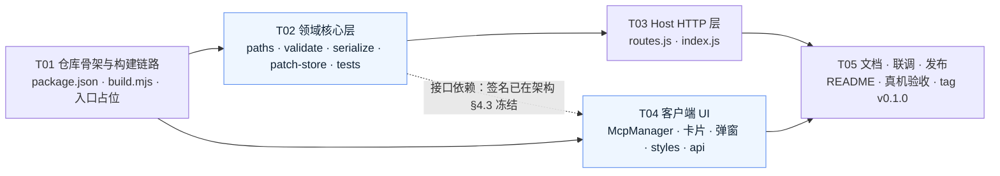

# 任务分解：dsh-mcpserver-manager v0.1.0

> 架构师：高见远 · 上游：`docs/software-company/prd.md` + `docs/software-company/architecture.md`
> **实现依据以 `architecture.md` 为准**。本文只定义「做什么、按什么顺序、怎么验收」。
> 共 **5 个任务**，全部 P0（P1/P2 不在本次实现范围，仅在 T04 预留骨架）。

---

## 0. 总览

| 任务号 | 标题 | 涉及文件数 | 前置 | 优先级 | 可并行 |
|---|---|---|---|---|---|
| **T01** | 仓库骨架与构建链路 | 9 | — | P0 | — |
| **T02** | 领域核心层（路径 / 校验 / 序列化 / 受管段读写）+ 单测 | 8 | T01 | P0 | 与 T04 并行 |
| **T03** | Host HTTP 层（4 端点 + 守卫 + 错误码） | 2 | T02 | P0 | 与 T04 并行 |
| **T04** | 客户端 UI（设置页 + 三态 + 主题） | 11 | T01（+T02 的签名） | P0 | 与 T02/T03 并行 |
| **T05** | 文档、真机联调与发布 | 3 | T03, T04 | P0 | — |

### 任务依赖图

**并行说明（蓝色两块）**
- **T02 与 T04 可并行**：T04 只依赖 `src/validate.js` 的**导出签名**，该签名已在 `architecture.md` §4.3 冻结。T04 先按签名直接 `import '../validate.js'`，T02 交付时保证签名一致即可；若 T02 尚未落地，T04 可在本地写一个同名同签名的 stub 顶住，T02 落地后删 stub。
- **T03 与 T04 可并行**：二者只通过 HTTP 契约耦合，契约已在 `architecture.md` §3.5 完整定义（路径、信封、错误码表）。
- **不可并行**：T02 ← T01（要先有可构建的骨架才能跑测试）；T05 ← T03 + T04。

---

## T01 · 仓库骨架与构建链路

**优先级** P0 · **前置** 无 · **可并行** 否

### 涉及文件

| 文件 | 动作 | 要点 |
|---|---|---|
| `package.json` | 新建 | 严格按 `architecture.md` §3.1 / PRD §3.4 形状：`type:module`、`main:./lib/index.js`、`exports` 四项、`files`、`dsh.bundle.patch`、`dsh.client.{platform:'web',inject:['@deepseek-ai/dsh-client-runtime','@deepseek-ai/dsh-client-ui-settings']}`、`keywords` 含 `dsh-plugin`、`scripts.{build,check,test}`。**`dependencies` 为空，`devDependencies` 仅 `esbuild@^0.24.0`** |
| `.gitignore` | 新建 | `node_modules/`、`lib/`、`.DS_Store`、`*.log` |
| `LICENSE` | 新建 | MIT，照抄 `dsh-ssh/LICENSE` |
| `icon.svg` | 新建 | ≤64×64 纯 SVG，无外链、无脚本；主题中性色 |
| `cordis.patch.yml` | 新建 | **bundle 层**，仅 `- insert: [- {id, name: 'dsh-mcpserver-manager'}]` |
| `scripts/build.mjs` | 新建（照抄 `dsh-ssh/scripts/build.mjs`） | 改三处：包名/id `dsh-mcpserver-manager`、`MAX_CLIENT_BYTES = 120*1024`、入口 `src/client/entry.js`。保留：目录扫描拷贝 Host 半、`node --check`、`__ModuleLoader__` 包装、external 白名单校验、`--check` 临时目录模式、按 UTF-8 字节算体积 |
| `src/index.js` | 新建（骨架） | `export const inject = ['webServer','connection']`；`export function apply(ctx, config)` 先只做 `createLogger` + `registerRoutes(...)` 的调用点（T03 补完） |
| `src/client/entry.js` | 新建（骨架） | `export { inject, apply } from './launchpad.js'` |
| `src/client/launchpad.js` | 新建（骨架） | `export const inject = ['slots','sessions']`；`apply` 里 `ctx.slots.inject('settings.section', () => ctx.slots.register({name:'settings.section', id:'dsh-mcpserver-manager', order:17, label:'MCP 管理'}, () => <占位 div/>))` |

### 验收标准

1. `npm install` 后 `npm run build` 无报错，产出 `lib/index.js` 与 `lib/client.js`。
2. `npm run check` 绿（临时目录模式，`lib/` 不被触碰）。
3. `lib/client.js` 首行为 `window.__ModuleLoader__.load({`，`id` 为 `dsh-mcpserver-manager`。
4. `grep -c "createElement" lib/client.js` 命中的只是 `React.createElement` 调用，**不含 React 自身实现**；`require('...')` 只出现 `react` / `react-dom`（build.mjs 已校验，人工复核一次）。
5. `lib/client.js` 体积 ≤ 120KB，构建日志打印体积与预算占比。
6. 把 `MAX_CLIENT_BYTES` 临时改小能**构建失败**（证明门禁真的生效）。

---

## T02 · 领域核心层（零依赖）+ 单元测试

**优先级** P0 · **前置** T01 · **可并行** 与 T04 并行 · **风险最高，先做**

### 涉及文件

| 文件 | 动作 | 要点 |
|---|---|---|
| `src/paths.js` | 新建 | `resolveDshHome(env)` / `resolvePatchPath(config, env)` / `toDisplayPath(abs, home)`。纯函数无 I/O；优先级 `DSH_HOME` → `~/.dsh` |
| `src/config.js` | 新建 | `DEFAULT_CONFIG = {profile:'web', backup:true}`；`normalizeConfig(raw)` **永不抛错**，非法值回落默认 |
| `src/validate.js` | 新建 | **前后端同源单一数据源**。导出常量 `SERVER_NAME_RE`/`TRANSPORTS`/`DEFAULTS`/`KNOWN_FIELDS`，函数 `parseJsonWithPosition` / `validateConfig` / `checkUniqueness` / `validateServerInput`。16 条规则 + code + path + 行号。**禁止 import 任何 Node 内置模块，禁止触碰 `window`/`document`** |
| `src/serialize.js` | 新建 | `serializeEntry()`（canonical 键序 → YAML 行数组，单引号转义，块风格 args/env）、`quoteScalar`、`detectNewline`、`redactEnvValues`（`!!js` 值原样，其余 → `'••••'`） |
| `src/patch-store.js` | 新建 | `scan` / `findAnchors` / `ensureBlock` / `insertEntry` / `removeEntry` / `replaceEntry` / `applyDisable`（受 `DISABLE_STRATEGY` 开关控制）+ `createPatchStore({filePath, config, env, fs})` 的 `read/add/remove/setEnabled` + mutex + 原子写 + `.bak` + 回滚 |
| `tests/patch-store.test.js` | 新建 | **必做**（Q11） |
| `tests/validate.test.js` | 新建 | 16 条规则逐条正反用例 |
| `tests/serialize.test.js` | 新建 | 序列化往返 / 脱敏 / 换行符 / 单引号转义 |

### 验收标准

1. `npm test` 全绿（Node 内置 `node:test`，无第三方测试框架）。
2. **`tests/patch-store.test.js` 必须覆盖架构 §6.4 的六条不变量**：
   - **I1 段外字节不变**：6 种初始文件（空文件 / 仅注释 / 仅 1 条非 MCP 条目 / 已有用户手写 MCP 条目 / 已有受管段 / 受管段为空）× 各 20 次随机增删，断言段前段后内容 md5 与初始一致；
   - **I2 崩溃安全**：stub 的 fs 在 `rename` 前抛错，断言文件内容 ∈ {原文本}；
   - **I3 回滚完备**：stub 在 `writeFileSync(tmp)` 抛错，断言文件 md5 == 操作前 md5 且 `.bak` 存在；
   - **I4 读不改**：`read()` 前后 mtime 不变；
   - **I5 追加不破坏**：`NO_ANCHORS` 首次写入后，原文件全部内容仍是结果前缀；
   - **I6 脱敏**：`env:{TOKEN:'secret-abc'}` 的条目，`raw` 不含 `secret-abc` 但含 `TOKEN` 与 `••••`。
3. **幂等用例**：`add(s)` 连续两次 → 第二次 409；`remove(s)` 连续两次 → 第二次 404；`setEnabled(s,false)` 连续两次 → 第二次 `changed:false` 且不落盘；`ensureBlock()` 连续两次 → 输出逐字节相同。
4. **初始状态用例**：文件里有用户手写的 MCP 条目但**没有锚点** → `read()` 返回 1 条 `managed:false`；随后 `add()` 另一条 → 用户条目仍在段外且字节不变。
5. **锚点损坏用例**：只有 begin / 顺序颠倒 / 重复 begin → `anchors:'broken'`，写操作抛 `anchors-broken`，读仍可用。
6. `tests/validate.test.js` 至少覆盖架构 §4.2 全部 16 条的「合规」与「违规」两侧。
7. 全仓库 `grep -rn "require('fs')\|from 'node:" src/validate.js` **无命中**。
8. 零运行时依赖：`package.json` 的 `dependencies` 仍为空。

---

## T03 · Host HTTP 层

**优先级** P0 · **前置** T02 · **可并行** 与 T04 并行

### 涉及文件

| 文件 | 动作 | 要点 |
|---|---|---|
| `src/routes.js` | 新建 | 4 个端点（见架构 §3.5）。`register(kind,path,handler)` 里**首行 `rejected(ctx,req,res)`**（照 `dsh-ssh/src/routes.js:475` 的 `ctx.effect(() => ctx.webServer.register(...))` 写法）；`exact /servers` 处理 GET+POST，`prefix /servers/` 处理 DELETE 与 toggle；`serverNameFromPath` 用 `decodeURIComponent` + `SERVER_NAME_RE` 复核 |
| `src/index.js` | 改（补全） | `normalizeConfig` → `resolvePatchPath` → `createPatchStore` → `registerRoutes(ctx, store, logger)`；日志前缀 `[dsh-mcpserver-manager] `，只打 serverName/错误码/路径 |

### 验收标准

1. 4 个端点全部可达：`GET /servers`、`POST /servers`、`DELETE /servers/<name>`、`POST /servers/<name>/toggle`。
2. **每个 handler 的第一条语句是 `requestRejection` 守卫**（用 grep 复核：4 处注册共用同一个 `register()` 包装，守卫在包装内首行）。
3. 错误码表 13 个码全部有对应抛出路径，且 HTTP 状态码映射正确（对照架构 §3.5 表格）。
4. `POST` body > 256KB → 413 `body-too-large`；方法不匹配 → 405。
5. `POST` 一个含未知字段 `"foo": 1` 的配置 → **200/201 且文件里出现 `foo: 1`**（Q8 原样写入）；响应 `errors` 里有一条 `W_UNKNOWN` 警告。
6. 真实写入一次后：`~/.dsh/profiles/web/cordis.patch.yml` 出现受管段与条目；`.bak` 存在；宿主热重载后该 MCP 生效（此条在 T05 真机复验）。
7. 删除后再删除 → 404 `unknown-server`；对段外只读条目删除 → 409 `readonly-entry`。
8. 日志中搜索不到任何 `env` 值或 token 明文。

---

## T04 · 客户端 UI

**优先级** P0 · **前置** T01（+T02 的 `validate.js` 签名，已冻结） · **可并行** 与 T02/T03 并行

### 涉及文件

| 文件 | 动作 | 要点 |
|---|---|---|
| `src/client/launchpad.js` | 改（补全） | `slots.inject('settings.section', ...)` 渲染 `<McpManager/>`；`order:17`、`label:'MCP 管理'`（PRD P0-3） |
| `src/client/McpManager.jsx` | 新建 | 页面容器：`` + 三态分发（loading skeleton / empty / error banner / list）+ 全局 banner + 新条目高亮 1.5s + 刷新 |
| `src/client/Toolbar.jsx` | 新建 | 标题「MCP 服务器」+ 副标题（含 `fileDisplay` 路径）+ 主按钮「添加 MCP」+ 刷新图标按钮。**搜索框/筛选下拉只留 P1 占位（不渲染或 disabled）** |
| `src/client/EmptyState.jsx` | 新建 | 48px 内联 SVG + 主文案 + 副文案（写入文件路径）+ 主按钮 |
| `src/client/ServerList.jsx` | 新建 | 受管分组 + 「非本插件管理 · 只读」分组（置灰、无操作菜单） |
| `src/client/ServerCard.jsx` | 新建 | 状态点 / serverName / transport chip / 命令行（等宽 12px 单行截断 + `title` 全量）/ 元信息（env keys + `••••`、超时）/ ⋯ 菜单（停用启用、删除红字；编辑与复制为 JSON 标「即将上线」禁用）/ 启停开关 |
| `src/client/AddDialog.jsx` | 新建 | JSON 编辑器（等宽 12px/行高 20px，保留缩进）+ 「填入示例 ▾」（stdio / streamable-http 两套）+ 实时错误区（调 `validateServerInput`）+ 「写入位置」说明行 + 取消/确定（未通过时禁用，提交中 loading 防重复点击） |
| `src/client/ConfirmDialog.jsx` | 新建 | 删除二次确认（红字危险按钮，可取消） |
| `src/client/Icons.jsx` | 新建 | 内联 SVG：plus / more / refresh / warning / info / empty-state。**16px（空态 48px）、`stroke:currentColor`、`stroke-width:1.5`** |
| `src/client/styles.js` | 新建 | 导出 CSS 字符串；作用域 `.dshmcp-`；**全量 `var(--dsw-alias-*, #fallback)`**；8px 栅格（4/8/12/16/24）；字号只用 11/12/13/14（+页面标题 20）；圆角只用 6/8/10/12；一屏只有一个实心主按钮 |
| `src/client/api.js` | 新建 | `list/create/remove/toggle` 四个 fetch（相对路径 + `cache:'no-store'`）+ `messageFor(code)` 中文文案映射（13 个码 + 通用回落） |

### 验收标准

1. 设置左侧导航出现「MCP 管理」，点击后右侧渲染本页，与 DSH HUB 市场（order 16）共存无样式冲突。
2. **三态齐备**：空文件 → 空态；加载中 → skeleton（用 `--dsw-alias-bg-skeleton`）；后端 500 → 顶部红色 banner + 重试。
3. 粘贴一段合法 JSON → 「确定」可用 → 提交 → 弹窗关闭 → 列表出现新条目并高亮 1.5s → 刷新浏览器后与文件一致。
4. 粘贴非法 JSON → 错误区显示「第 N 行」+ 原因，「确定」禁用。
5. 重名提交 → 错误区显示 `serverName "x" 已存在，请换一个名字`。
6. 删除 → 二次确认弹窗（可取消）→ 确认后列表与文件同步减少。
7. 停用 → 卡片置灰标「已停用」；再启用 → 完整恢复（含 `env` 与 `!!js`）。
8. **主题**：CSS 中除 `var(...)` 的 fallback 外**不出现第二处硬编码色值**（grep `#xxx`/`rgb(` 只应命中 fallback）；明暗切换后所有区域对比度可读；**无任何 JS 明暗判断**（grep `matchMedia`/`prefers-color-scheme` 无命中）。
9. **安全**：列表与 `raw` 中**不出现 env 明文**（用 `TOKEN: 'secret-abc'` 实测，页面 DOM 里搜不到 `secret-abc`）。
10. `npm run build` 后体积仍 ≤ 120KB（预期 25–40KB）。

---

## T05 · 文档、真机联调与发布

**优先级** P0 · **前置** T03 + T04 · **可并行** 否

### 涉及文件

| 文件 | 动作 | 要点 |
|---|---|---|
| `README.md` | 新建/补齐 | 功能说明、安装方式、用法（粘贴 JSON → 确定 → 生效）、**写入位置 `~/.dsh/profiles/web/cordis.patch.yml`**、受管段锚点说明与「请勿手改」警示、`.bak` 手工恢复方法、`config.profile` / `DSH_HOME` 说明、示例配置（stdio + streamable-http 两套）、MIT License。`keywords` 已含 `dsh-plugin`（Q10） |
| `docs/software-company/prd.md` | 改（补记） | 在 §6 表格下方追加「team-lead 裁决结果」小节，把 Q3 改为「采用原生 `disabled`」、Q2 改为「全文件扫描 + 只读分组」，避免后人按旧文实现 |
| Git 仓库 | 新建 | `git init` → commit → 打 `v0.1.0` tag → 推送到 `github.com/liuleiyu121520/dsh-mcpserver-manager`（公开） |

### 验收标准

1. 在**真实 DSH 宿主**里装一次（软链或 `npm i` 到 `~/.dsh/profiles/web/node_modules/`），走通：打开设置页 → 添加一条真实 MCP（如 stdio 的 filesystem）→ 宿主热重载 → 会话里 `mcp__<serverName>__<tool>` 可用。
2. 写入后 `cat ~/.dsh/profiles/web/cordis.patch.yml` 确认：受管段锚点在、缩进正确、`!!js` 与用户原有条目未被破坏、`.bak` 存在。
3. 连续增删 20 次后，段外内容与初始 `md5` 一致（T02 单测已覆盖，真机再抽验一次）。
4. `npm run build && npm run check && npm test` 三条全绿。
5. GitHub 仓库公开可访问，含 `README.md` / `LICENSE` / `icon.svg` / `cordis.patch.yml` / `lib/`（`lib/` 需提交，DSH 直接读产物）。
6. **`https://dsh-hub.cc/plugins/liuleiyu121520/dsh-mcpserver-manager` 可访问**（Q10 的验收点）。若不可访问，检查 `keywords` 是否含 `dsh-plugin`、`package.json` 的 `dsh` 字段是否合规，并把结论回报 team-lead。

---

## 附：本次**不做**（P1/P2，仅在 T04 留骨架或注释）

| ID | 项 | 备注 |
|---|---|---|
| P1-1 | 编辑已存在条目 | `replaceEntry()` 已在 T02 实现并单测，**只差路由与 UI** |
| P1-2 | 搜索 + 状态筛选 | Toolbar 留占位 |
| P1-4 | 卡片「复制为 JSON」/「导出全部」 | 菜单项禁用并标「即将上线」 |
| P1-5 | 「N 个工具」展开 | 依赖宿主是否暴露 MCP 运行时查询服务（PRD Q4），未暴露则整条降级 |
| P1-8 | 国际化 | v0.1.0 只做中文（Q7） |
| P2-1 | 测试连接 | — |
| P2-2 | 管理非本插件写入的条目 | Q2 裁决为只读展示，已在 T04 落地 |
| P2-3 | 配置漂移检测 | `revision`/`checksum` 已返回，UI 未用 |
| P2-4 | 多版本备份管理 | 仅单份 `.bak`（Q9） |

## 附：给工程师的三条硬纪律

1. **不要引入任何运行时依赖**（`dependencies` 必须为空）。需要什么先问架构。
2. **`src/validate.js` 不得 import Node 内置模块**，它是 Client bundle 的一部分。
3. **永远不要"解析 YAML → 改对象 → 全量 dump"**。`patch-store.js` 里一切写操作都必须是「在 `scan` 出来的行区间上做字符串拼接」。这一条被破坏 = 用户的配置文件被毁 = 本次交付失败。
